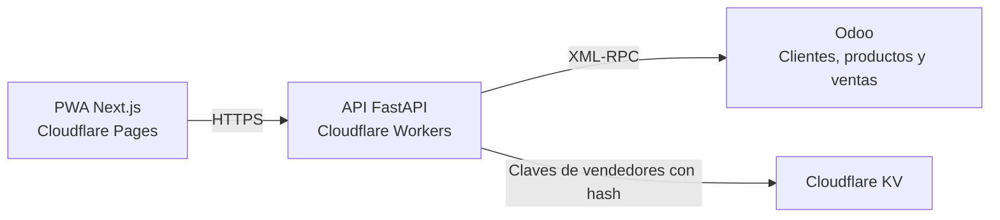

# RapyVet Pedidos

Aplicación web instalable (PWA) para que el equipo comercial de RapyVet capture cotizaciones desde el teléfono o la computadora. Los vendedores consultan el catálogo, preparan el carrito y registran la cotización en Odoo con su usuario asignado.

[Abrir la aplicación](https://rapyvet-pedidos.pages.dev) · [Manual de usuario (PDF)](Manual_RapyVet_Pedidos.pdf)

## Funciones principales

- Acceso por vendedor, con una clave temporal y cambio de clave al ingresar por primera vez.
- Consulta de clientes y productos, búsqueda por nombre o código y alta de clientes desde la aplicación.
- Carrito editable con precios, cantidades, impuestos y promociones. Una promoción de 10+2 genera una línea con 10 unidades cobradas y otra con 2 unidades gratuitas.
- Revisión antes de registrar la cotización en Odoo, descarga en PDF y opción de compartir por WhatsApp.
- Catálogo guardado en el dispositivo y bandeja de envíos pendientes. Al volver la conexión, la app reintenta el envío con la misma referencia para evitar duplicados.
- Historial por vendedor, edición de cotizaciones abiertas y consulta del estado de cuenta de clientes.

## Arquitectura



| Ruta | Contenido |
| --- | --- |
| [`frontend/`](frontend/) | PWA con Next.js, React, TypeScript y Motion. |
| [`cloudflare_worker/`](cloudflare_worker/) | API de producción en Python y FastAPI. |
| [`backend/`](backend/) | API FastAPI para desarrollo local y despliegue en contenedor. |
| [`rapyvet/`](rapyvet/) | Funciones de clientes, impuestos y conexión con Odoo. |
| [`app.py`](app.py) | Versión anterior en Streamlit. |
| [`tests/`](tests/) | Pruebas automatizadas de la API y la lógica de negocio. |

## Ejecutar en local

Los comandos usan PowerShell. Para la PWA necesitas Node.js 20.9 o posterior y pnpm 10.4.1. Para la API local, usa Python 3.12 y una cuenta de Odoo con acceso a la base y permisos para las operaciones que quieras probar.

```powershell
git clone https://github.com/IsraAra12/AppSheet_Odoo_Sync.git
cd AppSheet_Odoo_Sync
```

### 1. Iniciar la API

Desde la raíz del repositorio, crea el entorno virtual y copia el archivo de ejemplo.

```powershell
python -m venv .backend-venv
.\.backend-venv\Scripts\python.exe -m pip install -r backend/requirements.txt
Copy-Item .env.example .env
```

Edita `.env` con los datos de tu entorno.

| Variables | Configuración |
| --- | --- |
| `ODOO_URL`, `ODOO_DB`, `ODOO_USER`, `ODOO_PASSWORD` | URL, base, usuario y contraseña o clave de API de Odoo. |
| `APP_ACCESS_PIN` | Clave de administración de al menos 6 caracteres. |
| `APP_SESSION_SECRET` | Secreto aleatorio de al menos 32 caracteres para firmar las sesiones. |
| `FRONTEND_ORIGINS` | Orígenes autorizados, separados por comas. Para desarrollo usa `http://localhost:3000`. |
| `CONFIRM_ORDERS` | Con `false`, la API registra cotizaciones en Odoo. Con `true`, también las confirma como pedidos. |

```powershell
.\.backend-venv\Scripts\python.exe -m uvicorn backend.main:app --reload --port 8080
```

El estado de la API se puede consultar en [`/health`](http://localhost:8080/health) y su documentación interactiva en [`/docs`](http://localhost:8080/docs).

### 2. Iniciar la PWA

En otra terminal, desde la raíz del repositorio, copia la configuración local del frontend. El archivo de ejemplo apunta a `http://localhost:8080`.

```powershell
cd frontend
Copy-Item .env.example .env.local
pnpm install --frozen-lockfile
pnpm dev
```

Abre [`http://localhost:3000`](http://localhost:3000). Guarda las credenciales de Odoo y las claves de sesión en el entorno de la API. `NEXT_PUBLIC_API_URL` queda visible en el navegador.

## Pruebas y compilación

Desde la raíz, instala la dependencia que requieren las pruebas del Worker y ejecuta la suite.

```powershell
.\.backend-venv\Scripts\python.exe -m pip install httpx==0.28.1
.\.backend-venv\Scripts\python.exe -m unittest discover -s tests -v
```

Desde `frontend/`, comprueba los tipos y genera la compilación estática en `out/`.

```powershell
pnpm typecheck
pnpm build
```

## Despliegue

Cloudflare Pages publica la exportación estática de `frontend/`. La compilación usa la URL de la API indicada en [`frontend/.env.production`](frontend/.env.production). Cloudflare Workers ejecuta la API y usa el binding `RAPYVET_SELLER_AUTH` para guardar las claves de vendedores con hash.

- [Guía de despliegue en Cloudflare Pages y Workers](CLOUDFLARE_DEPLOY.md)
- [Configuración y comandos del Worker](cloudflare_worker/README.md)
- [Plan original de migración de Streamlit a la PWA](MIGRACION_PWA.md)

## Versión anterior en Streamlit

Desde la raíz, crea `.streamlit/secrets.toml` con los datos de tu instancia de Odoo.

```toml
[odoo]
url = "https://tu-empresa.odoo.com"
db = "tu_base"
user = "usuario@empresa.com"
password = "clave_o_api_key"
```

```powershell
python -m venv .venv
.\.venv\Scripts\python.exe -m pip install -r requirements.txt
.\.venv\Scripts\python.exe -m streamlit run app.py
```

Abre [`http://localhost:8501`](http://localhost:8501). Puedes forzar la interfaz con [`?ui=mobile`](http://localhost:8501/?ui=mobile) o [`?ui=desktop`](http://localhost:8501/?ui=desktop).

Proyecto de uso interno de RapyVet.
